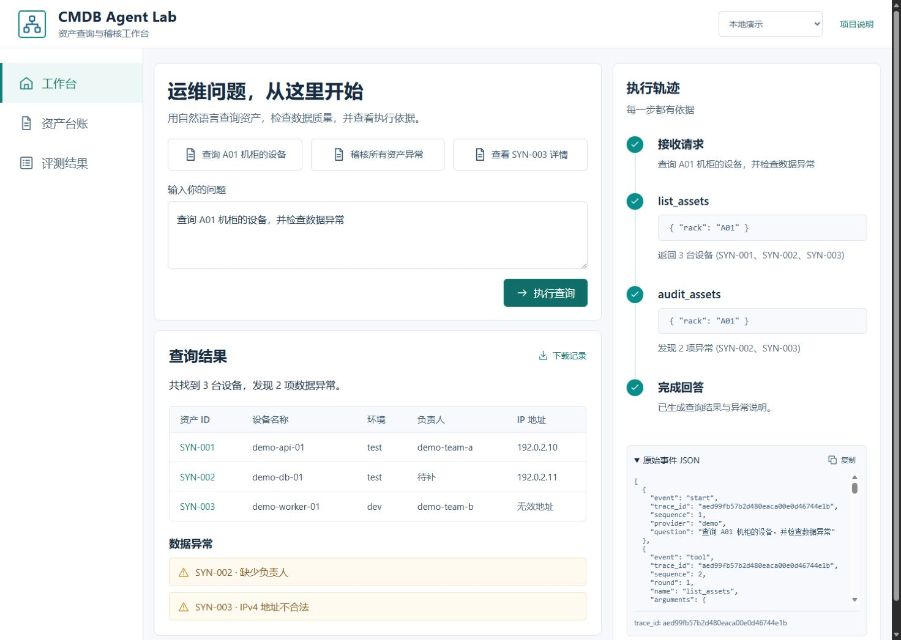
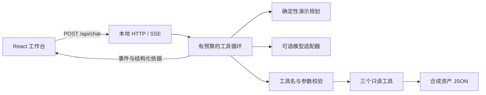

# CMDB Agent Lab

自然语言查询合成资产、执行数据稽核，并用 SSE 展示完整工具调用轨迹的本地演示项目。面向 Agent 应用开发学习与面试讲解，**AI 辅助实现，使用合成数据**。



## 30 秒启动

需要 **Python 3.11+** 和现代浏览器。默认演示无需 GPU、API Key、pip 安装或 Node.js；仓库自带已编译页面。

```bash
git clone https://github.com/wangxinyu-42/cmdb-agent-lab.git
cd cmdb-agent-lab
python run.py
```

打开 [http://127.0.0.1:8091](http://127.0.0.1:8091)。Windows 也可双击 `start.cmd`；macOS / Linux 使用 `python3 run.py` 或 `sh start.sh`。按 `Ctrl+C` 停止。

如果端口占用：`python run.py --port 8092`。无桌面或不希望自动打开浏览器：`python run.py --no-browser`。本项目仅绑定本机回环地址。

无需 Git：在 GitHub 点 **Code → Download ZIP**，完整解压后进入包含 `run.py` 的目录运行同一命令。[详细启动与排错](docs/START.md)

## 三个可演示场景

| 输入 | 结果与证据 |
| --- | --- |
| 查询 A01 机柜的设备，并检查数据异常 | 3 台设备；SYN-002 缺少负责人、SYN-003 IPv4 不合法；轨迹含 list_assets 与 audit_assets |
| 稽核所有资产异常 | 8 台设备、3 项预设异常；额外发现 SYN-004 缺少机柜 |
| 查看 SYN-003 详情 | 返回单设备原始字段；点击资产 ID 查看详情 |

也可以输入“删除 SYN-001”验证只读拒绝，输入“查询 Z99 机柜的资产”验证空结果。示例按钮会填入问题，再点击“执行查询”。资产台账支持名称 / ID / 负责人搜索及机柜、环境组合过滤。

## 实现了什么

- **受控工具循环**：查询、详情、稽核三个只读工具；严格检查工具名、必填参数、类型、额外字段、调用 ID 与 JSON 格式；最多 4 轮、8 次工具调用。
- **执行依据**：SSE `start → tool → final/error`，每次请求生成 trace_id 与递增 sequence。前端显示调用参数、结果、异常和原始事件；支持复制与下载 JSON。
- **可复现演示**：8 条合成资产，使用文档示例地址段；不依赖企业数据。表格仅从工具结果构造。
- **模型适配边界**：默认确定性路由验证交互与工具协议；另有支持 function calling 的 chat-completions 适配器。真实模型接入失败、预算耗尽会显示错误。
- **工程验证**：17 项 unittest、20 条固定回归用例、GitHub Actions、前端构建与浏览器验收记录。

## 两种模式与验证范围

| 模式 | 行为 | 当前验证 |
| --- | --- | --- |
| 本地演示（默认） | 正则 / 规则规划工具调用，再从工具结果生成说明；**不是大模型推理** | 本地 20/20 固定回归用例通过；结果见 [report.json](evals/report.json) |
| 真实模型（可选） | 配置支持工具调用的 chat-completions 服务，由模型决定工具和最终说明 | HTTP 请求 / 响应协议与多轮执行路径通过测试替身验证；**未完成真实模型推理验收** |

20/20 只表示这个固定样例集通过，不是通用自然语言准确率、抗攻击认证或企业性能指标。真实模型的自然语言回答可能出错，应核对工具依据。关键词拒绝仅作体验防线，真正的只读边界来自工具集合与数据访问实现。

## 可选真实模型

先自行启动一个支持 `tools` / `tool_calls` 的兼容服务，例如 [llama.cpp server](https://github.com/ggml-org/llama.cpp/blob/master/tools/server/README.md)。模型本身和 chat template 必须支持工具调用。下面的模型 ID 需要与已有服务匹配：

```powershell
# PowerShell：在同一个终端设置并启动
$env:LLAMA_BASE_URL = 'http://127.0.0.1:8080/v1'
$env:LLAMA_MODEL = '服务实际提供的模型ID'
# 仅在服务要求鉴权时设置 LLAMA_API_KEY；不要把密钥写入仓库
python run.py
```

macOS / Linux：用 `export LLAMA_BASE_URL=...`、`export LLAMA_MODEL=...` 设置相同变量。配置通过后，页面的“真实模型”选项才可用。配置通过不等于服务已连通；调用失败会在轨迹中显示 `provider_error`。远程端点必须使用 HTTPS；禁止 URL 用户密码、query、fragment 和重定向转发凭据。

可用同一测试集另行评测真实模型：

```bash
python -m cmdb_agent.evaluation --provider llama --output evals/local-llama.json
```

真实模型未必采取与规则模式相同的工具顺序；报告同时列出工具链、资产 ID 和异常断言，需分别分析失败项，不应只看总分。此命令可能消耗模型服务资源；默认启动和 CI 不执行它。

## 测试与开发

```bash
python -m unittest discover -s tests -v
python -m cmdb_agent.evaluation
```

修改前端需要 Node.js 22.12+（本地使用 24）：

```bash
cd web
npm ci
npm run dev      # 后端先在另一个终端运行 python run.py --no-browser
npm run build    # 将 web/dist 一同提交，保持下载即用
```

生产演示由 Python 服务 `web/dist`；Vite 开发代理指向默认后端 8091。依赖锁定在 package-lock.json。前端开发服务无需暴露到公网。

## 架构与目录



| 路径 | 职责 |
| --- | --- |
| `cmdb_agent/runtime.py` | 消息历史、工具循环、预算、证据聚合 |
| `cmdb_agent/providers.py` | 确定性规划与模型 HTTP 适配 |
| `cmdb_agent/tools.py` / `assets.json` | 只读数据边界、参数校验与异常规则 |
| `cmdb_agent/server.py` | HTTP、SSE、静态文件、Host / Origin 校验、模型单请求限流 |
| `web/src/` / `web/dist/` | React 源码与预编译演示页面 |
| `tests/` / `evals/` | 契约测试与有断言、数据指纹的回归记录 |
| `docs/` | 启动说明、面试讲解、贡献记录与视觉验收 |

## 面试讲解与项目归属

这是公开学习演示项目，**初版由 Codex 辅助生成与验证**。不包含企业代码、真实资产或内部接口，不声称是独立手写、生产上线项目，也不把原实习中的设备数量或性能优化迁移为本项目成果。

建议先完整运行、阅读关键代码，并亲自完成一个可验证改动，再把自己的具体贡献写进简历。可按 [5 分钟演示脚本](docs/INTERVIEW.md) 讲解问题、工具边界、SSE 和评测取舍；[贡献与验证记录](docs/CONTRIBUTIONS.md) 明确当前归属与待完成内容。

当前限制：单用户本机演示、无登录 / 数据库 / 多租户、无写操作、无持久化会话；规则模式只覆盖列出的句式。浏览器取消会停止接收，已发出的模型 HTTP 请求可能继续直到超时（单次最多 30 秒）；60 秒总预算在调用返回后检查，并非强制终止线程。不应直接作为公网企业 CMDB 服务部署。

## 设计与参考

[设计概念](docs/design/concept.png) · [视觉与交互验收](docs/design/qa.md) · [React](https://react.dev/learn) · [Vite](https://vite.dev/guide/)。概念图用于视觉参考，实际界面由 React / CSS / SVG 原生实现。

代码采用 [MIT License](LICENSE)。React 等依赖版权声明见 [THIRD_PARTY_NOTICES.md](THIRD_PARTY_NOTICES.md)。
